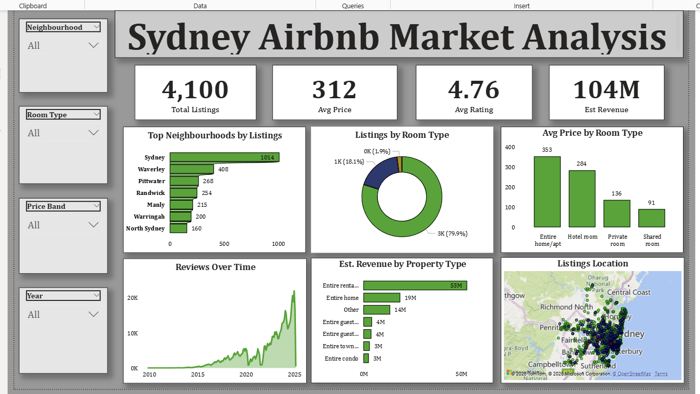

# Sydney Airbnb Market Analysis

An interactive Power BI dashboard exploring Airbnb listings in Sydney, including listing distribution, pricing, room types, reviews, and estimated revenue. Python and Pandas were used for data cleaning and preprocessing, and Power BI was used to build the dashboard.

## Dashboard Preview

## Project Objectives

- Explore Airbnb listing distribution across Sydney neighbourhoods.
- Compare prices across room types and property types.
- Review guest ratings and review trends.
- Examine estimated revenue across property types.
- Present the results in an interactive dashboard to support easier exploration of the market.

## Tools and Technologies

- **Python** — data preparation
- **Pandas** — data cleaning and preprocessing
- **Microsoft Power BI** — data analysis and dashboard development

## Data Preparation Workflow

1. Load the Airbnb listings dataset.
2. Inspect columns, data types, and data quality.
3. Clean and prepare the data using Python and Pandas.
4. Load the prepared data into Power BI.
5. Create measures, KPI cards, charts, and a map to explore the listings.

## Dashboard KPIs

The dashboard displays the following headline metrics (as shown in the current dashboard version):

| KPI | Displayed value |
|---|---:|
| Total Listings | 4,100 |
| Average Price | 312 |
| Average Rating | 4.76 |
| Estimated Revenue | 104M |

## Dashboard Features

- Listing distribution by neighbourhood
- Listing breakdown by room type
- Average price comparison
- Reviews over time
- Estimated revenue by property type
- Map-based listing exploration
